# Contributing & Release Workflow Guide

This document defines the branching strategy, testing requirements, deployment model, and release process for **RetailPOS**.

---

## 1. Branch Strategy

To ensure stability and prevent broken or accidental deployments, work should be developed on feature branches and merged via Pull Requests.

| Branch | Purpose | Deployment Target |
| :--- | :--- | :--- |
| `main` | Production-ready, verified code | Production deployment |
| `feature/*` | Feature development, improvements, or fixes | GitHub Actions CI validation |

---

## 2. Standard Development Flow

```mermaid
flowchart LR
    A["git checkout main<br/>git pull origin main"] --> B["git checkout -b feature/name"]
    B --> C["Code & Test Locally<br/>dotnet test"]
    C --> D["git push -u origin feature/name"]
    D --> E["Open Pull Request to main"]
    E --> F["CI Validation Passes"]
    F --> G["Merge PR into main"]
    G --> H["Auto-Deploys Live"]
    H --> I["Tag Release: git tag -a vX.Y.Z"]
    I --> J["git push origin vX.Y.Z<br/>GitHub Release Created"]
```



### Step 1: Create a Feature Branch
Always start from the latest `main`:
```bash
git checkout main
git pull origin main
git checkout -b feature/your-feature-name
```

### Step 2: Make Changes & Test Locally
Before committing, make sure your tests pass locally:
```bash
# Run unit tests
dotnet test tests/POSApp.Tests.Unit/POSApp.Tests.Unit.csproj

# Run integration tests (requires Docker / PostgreSQL)
dotnet test tests/POSApp.Tests.Integration/POSApp.Tests.Integration.csproj
```

### Step 3: Commit and Push to the Feature Branch
```bash
git add .
git commit -m "feat: describe your change"
git push -u origin feature/your-feature-name
```

### Step 4: Open a Pull Request & Merge
1. Open a Pull Request from `feature/your-feature-name` into `main`.
2. The GitHub Actions CI pipeline will automatically run build and unit tests on the PR.
3. Once approved and tests pass, merge the PR into `main`.

---

## 3. Tagging & GitHub Releases

We adhere to [Semantic Versioning (SemVer)](https://semver.org/) (`vMAJOR.MINOR.PATCH`):
- `v0.x.x`: Initial development & pre-releases (e.g., `v0.1.0-preview.1`).
- `v1.0.0`: First stable major production release.
- `vX.Y.Z`: Production stable releases.

### Creating a New Release
After merging your PR into `main`:
```bash
git checkout main
git pull origin main

# Create an annotated tag
git tag -a v0.2.0 -m "Release v0.2.0: Summary of features"

# Push the tag to GitHub
git push origin v0.2.0
```

When the tag is pushed, the GitHub Actions `Release` workflow automatically drafts and publishes the GitHub Release with generated release notes.
